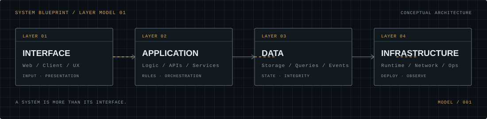

<div align="center">



<br/>

**ENGINEERING IS THE ART OF MAKING COMPLEXITY WORK.**

`SOFTWARE` · `SYSTEMS` · `INFRASTRUCTURE` · `PRODUCTS`

<br/>

[](https://github.com/Karimi-p)
[](https://github.com/Karimi-p)
[](https://github.com/Karimi-p)

</div>

---

<table>
<tr>
<td width="58%" valign="top">

### 01 / PERSONNEL FILE

**Karimi Waithaka**

Software engineer. Builder. Founder in progress.

I work across software development and IT infrastructure, with a particular interest in building practical systems that solve operational problems.

I like understanding what sits beneath the interface: architecture, data, networks, infrastructure and the decisions that make software dependable.

My goal is to turn useful ideas into working products — then make those products reliable enough for people to depend on.

</td>
<td width="42%" valign="top">

### FIELD NOTES

```text
IDENTITY    KW / 001
BASE        KENYA, EAST AFRICA
DISCIPLINE  SOFTWARE + SYSTEMS
METHOD      DESIGN / BUILD / TEST
DIRECTION   PRODUCT ENGINEERING
STATUS      IN PROGRESS
```

**Operating principle**

> Build useful things. Understand every layer. Leave the system better than you found it.

</td>
</tr>
</table>

## 02 / ENGINEERING DEPARTMENTS

<div align="center">

| SOFTWARE ENGINEERING | SYSTEMS & INFRASTRUCTURE | INTELLIGENT WORKFLOWS |
|:---:|:---:|:---:|
| Backend development | Networking & Linux | AI-assisted systems |
| Web applications | Troubleshooting | Process automation |
| Data & APIs | Systems operations | Practical integrations |

</div>

## 03 / THE WORKBENCH

These are selected projects and development tracks. Their descriptions distinguish work in progress from completed production systems.

<table>
<tr>
<td width="50%" valign="top">

#### `01` — DUKAFLOW

**Shop operations & eTIMS workflow**

A project exploring a simpler sales and invoicing workflow for Kenyan shopkeepers, including KRA eTIMS integration.

`PRODUCT ENGINEERING` `KENYA` `IN PROGRESS`

[Explore repository →](https://github.com/Karimi-p?tab=repositories)

</td>
<td width="50%" valign="top">

#### `02` — FLOWALPHA

**Market analysis & trading systems**

An engineering project exploring market data, structured analysis and rule-based signal evaluation.

`PYTHON` `SYSTEM DESIGN` `EXPERIMENTAL`

[Explore repository →](https://github.com/Karimi-p?tab=repositories)

</td>
</tr>
<tr>
<td width="50%" valign="top">

#### `03` — CLIENT SYSTEMS

**Websites & digital operations**

Practical work building web experiences and digital tools for businesses, with an emphasis on clarity, maintainability and useful outcomes.

`WEB DEVELOPMENT` `DELIVERY`

</td>
<td width="50%" valign="top">

#### `04` — THE LAB

**Experiments & technical notes**

Small builds, infrastructure experiments and investigations into how software and systems behave.

`RESEARCH` `PROTOTYPES` `CONTINUOUS LEARNING`

</td>
</tr>
</table>

> Replace the repository links above with direct project URLs once the relevant repositories are public. Don't present prototypes as production deployments.

## 04 / TECHNICAL TOOLKIT

**Languages**


**Frameworks & application development**


**Tools & infrastructure**


## 05 / SYSTEMS THINKING



I care about the whole path from problem to dependable delivery:

`PROBLEM` → `MODEL` → `ARCHITECTURE` → `IMPLEMENTATION` → `TESTING` → `DEPLOYMENT`

## 06 / CURRENT TRANSMISSION



I'm interested in collaborating on thoughtful software, useful products and technically challenging problems.

If you're building something practical and care about how it is engineered, let's connect.

<div align="center">

[**VIEW MY REPOSITORIES**](https://github.com/Karimi-p?tab=repositories) &nbsp; / &nbsp; [**CONTACT VIA GITHUB**](https://github.com/Karimi-p)

<br/>

**THINK CLEARLY. BUILD PRECISELY. SHIP RELIABLY.**

<sub>KW / ENGINEERING DIVISION · PERSONAL PROFILE · EST. 2026</sub>

</div>
